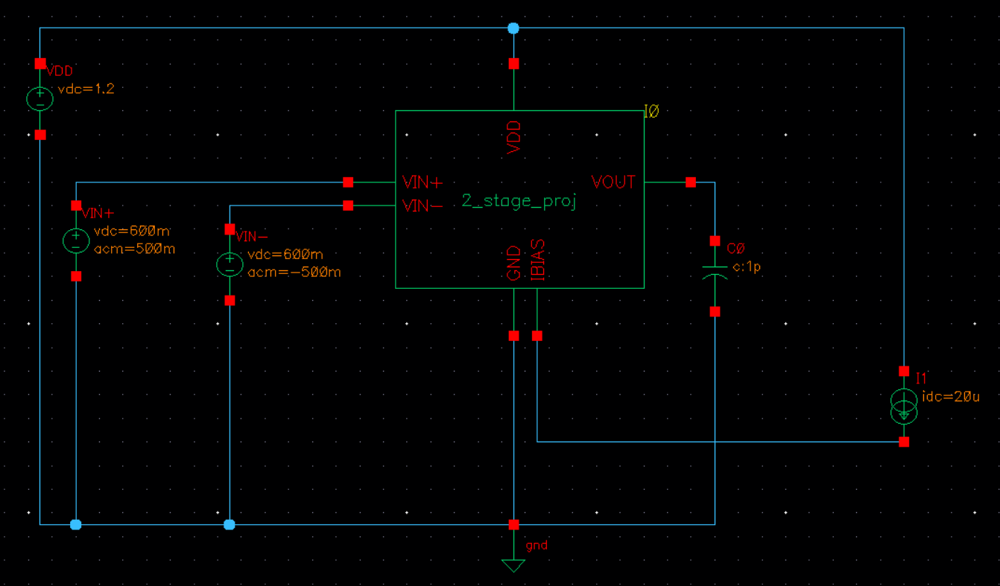
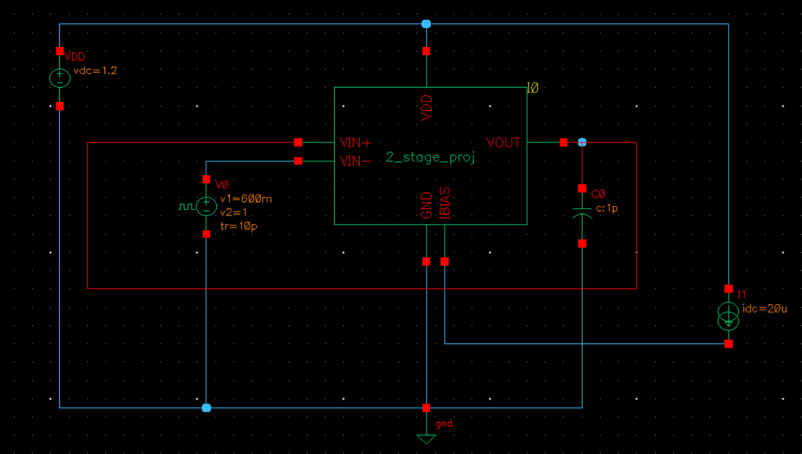
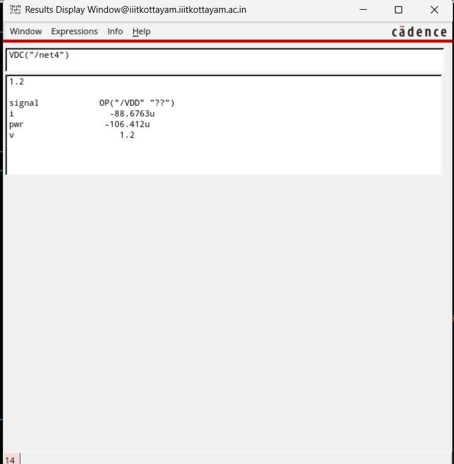

# 1.2 V Two-Stage Miller-Compensated CMOS Op-Amp in 90 nm (gm/ID Design)

Transistor-level design of a two-stage Miller-compensated operational amplifier on Cadence **GPDK090** (90 nm CMOS) with a 1.2 V supply. Because square-law equations are unreliable at this node (short-channel effects), every device is sized from **gm/ID charts** extracted from single NMOS and PMOS simulations. Designed and simulated in **Cadence Virtuoso (ADE, Spectre)**.

**Course:** Analog Electronics, B.Tech ECE, Indian Institute of Information Technology Kottayam

The project abstract is in [`docs/project_abstract.pdf`](two-stage-miller-opamp-90nm/two-stage-miller-opamp-90nm/docs/project_abstract.pdf).

---

## Contents

1. [Results Summary](#results-summary)
2. [Specifications and Design Methodology](#specifications-and-design-methodology)
3. [Design Considerations: Miller Compensation and Stability](#design-considerations-miller-compensation-and-stability)
4. [Device Characterization](#1-device-characterization)
5. [Circuit and Sizing](#2-circuit-and-sizing)
6. [Simulation Setup](#3-simulation-setup)
7. [Results](#4-results)
8. [Design Iterations](#design-iterations)
9. [Verification Status](#verification-status)
10. [Repository Structure](#repository-structure)
11. [Reproducing the Results](#reproducing-the-results)
12. [References](#references)

---

## Results Summary

Nominal simulation conditions, CL = 1 pF. Slew rate is measured in a unity-gain buffer.
<!-- TODO: confirm the AC testbench load capacitor is 1 pF before publishing -->

| Specification | Target | Achieved | Status |
|---|---|---|---|
| Technology | GPDK090 | GPDK090 | Met |
| Supply voltage | 1.2 V | 1.2 V | Met |
| Open-loop DC gain | ≥ 50 dB | **61.82 dB** | Met |
| Unity-gain bandwidth | ≥ 20 MHz | **26.73 MHz** | Met |
| Phase margin | ≥ 60° | **65.8°** | Met |
| Slew rate | ≥ 10 V/µs | **28.9 V/µs** rising, **27.8 V/µs** falling | Met |
| Power dissipation | ≤ 1 mW | **106.4 µW** | Met |
| Load capacitance | 1 pF | 1 pF | Met |

All specifications in the project abstract are met at nominal conditions.

---

## Specifications and Design Methodology

The design starts from the specifications and works backwards to device sizes. The relationships below are the standard two-stage op-amp design equations from Allen and Holberg (Sec. 6.3). The hand-calculated values use gm = (gm/ID) × I<sub>D</sub> with the chosen gm/ID of 10 V⁻¹, so they are design estimates rather than simulated values.

### From specification to design decision

| Specification | Governing relationship | Design decision |
|---|---|---|
| Slew rate ≥ 10 V/µs | SR = I<sub>5</sub> / C<sub>c</sub> | With C<sub>c</sub> = 0.5 pF, I<sub>5</sub> ≥ 5 µA. A 20 µA tail current was used for margin and for g<sub>m1</sub>. |
| Phase margin ≥ 60° (choice of C<sub>c</sub>) | C<sub>c</sub> > 0.22 C<sub>L</sub> | Minimum 0.22 pF. C<sub>c</sub> = 0.5 pF was used. |
| Unity-gain bandwidth ≥ 20 MHz | GBW = g<sub>m1</sub> / (2π C<sub>c</sub>) | g<sub>m1</sub> ≥ 63 µS for C<sub>c</sub> = 0.5 pF. Designed g<sub>m1</sub> ≈ 100 µS (10 V⁻¹ × 10 µA). |
| Phase margin ≥ 60° (second pole) | p<sub>2</sub> = g<sub>m6</sub> / C<sub>L</sub> ≥ 2.2 × GBW | g<sub>m6</sub> ≥ 2.2 · g<sub>m1</sub> · C<sub>L</sub> / C<sub>c</sub> ≈ 440 µS. Designed g<sub>m6</sub> ≈ 500 µS (10 V⁻¹ × 50 µA). |
| DC gain ≥ 50 dB | A<sub>0</sub> = g<sub>m1</sub>(r<sub>o2</sub>‖r<sub>o4</sub>) · g<sub>m6</sub>(r<sub>o6</sub>‖r<sub>o7</sub>) | L = 500 nm for every device, to raise g<sub>m</sub>·r<sub>o</sub> (see characterization plots). |
| Power ≤ 1 mW | P = V<sub>DD</sub> × I<sub>total</sub> | I<sub>total</sub> ≤ 833 µA allowed. The design draws about 89 µA. |

The designed g<sub>m1</sub> of 100 µS with C<sub>c</sub> = 0.5 pF gives a hand-estimated GBW of about 32 MHz. The simulated 26.7 MHz is lower because the real g<sub>m</sub> and the output resistances differ from the ideal chart values and parasitic poles add delay.

### Procedure

1. **Characterize** single NMOS and PMOS devices (DC sweep of VGS at several channel lengths) and extract gm/ID vs ID/W and gm/ID vs gm·ro.
2. **Choose the operating point.** All devices use gm/ID = 10 V⁻¹ (moderate inversion) and L = 500 nm. The longer length gives much better intrinsic gain than minimum length, which is needed to reach the gain target with two stages.
3. **Size from the charts.** W = I<sub>D</sub> ÷ (I<sub>D</sub>/W at the chosen gm/ID and L). At gm/ID = 10 and L = 500 nm: I<sub>D</sub>/W ≈ 9.79 µA/µm (NMOS) and ≈ 4.43 µA/µm (PMOS).
4. **Set currents** with a 20 µA bias reference and mirror ratios. The second-stage current (50 µA) is set so that V<sub>SG6</sub> matches V<sub>SG4</sub>, which keeps systematic offset low.
5. **Compensate** with a Miller capacitor and nulling resistor, then tune for UGB and phase margin.
6. **Verify** with DC operating point, AC, transient and power measurements, and iterate where a specification fails.

---

## Design Considerations: Miller Compensation and Stability

### Why compensation is needed

A two-stage op-amp has two low-frequency poles, one at the output of each stage. Without compensation these poles sit close together, so the loop gain is still well above 0 dB when the phase approaches −180°, and the amplifier would be unstable in feedback.

### Miller compensation and pole splitting

A capacitor C<sub>c</sub> is connected from the stage-1 output to the op-amp output, around the second-stage gain. The Miller effect makes it look like a very large capacitance at the stage-1 output, so it does two things at once:

- It pushes the **dominant pole p<sub>1</sub>** to a low frequency. For this design, a gain of 61.8 dB and a UGB of 26.7 MHz put p<sub>1</sub> at about 22 kHz, which matches where the gain starts to roll off in the AC plot.
- It pushes the **second pole p<sub>2</sub>** out to higher frequency, p<sub>2</sub> ≈ g<sub>m6</sub> / C<sub>L</sub>. With g<sub>m6</sub> ≈ 500 µS and C<sub>L</sub> = 1 pF this is about 80 MHz, roughly three times the unity-gain frequency.

This separation of the two poles is called **pole splitting**. The phase margin is then set by how far p<sub>2</sub> (and the zero below) lie beyond the unity-gain frequency.

### The right-half-plane zero

The feed-forward path through C<sub>c</sub> creates a zero at z = g<sub>m6</sub> / C<sub>c</sub>, which lies in the **right half-plane**. A right-half-plane zero raises the gain like a normal zero but adds phase lag like a pole, which erodes phase margin. For this design:

- z ≈ g<sub>m6</sub> / C<sub>c</sub> ≈ 500 µS / 0.5 pF, about 160 MHz (hand estimate).
- That is only about 6× the unity-gain frequency, below the usual guideline of at least 10×, so the zero costs noticeable phase margin if left uncorrected.

### Nulling resistor R<sub>z</sub>

A resistor R<sub>z</sub> in series with C<sub>c</sub> moves the zero to

z = 1 / [ C<sub>c</sub> (1/g<sub>m6</sub> − R<sub>z</sub>) ]

- With R<sub>z</sub> = 1/g<sub>m6</sub>, the zero moves to infinity.
- With R<sub>z</sub> > 1/g<sub>m6</sub>, it moves into the **left half-plane** and adds phase lead.

Here 1/g<sub>m6</sub> ≈ 2 kΩ, so **R<sub>z</sub> = 2 kΩ** was chosen. In simulation, raising R<sub>z</sub> from 1 kΩ to 2 kΩ improved the phase margin from about 61° to 65.8° with no change in gain or UGB, consistent with this reasoning.

### Stability trade-offs seen in this design

| Parameter | Effect of increasing it | Observed here |
|---|---|---|
| C<sub>c</sub> | Lowers UGB and slew rate, raises phase margin | With C<sub>c</sub> near 1 pF the UGB was only 13.6 MHz. With 0.5 pF it reached 26.7 MHz. |
| g<sub>m6</sub> (second-stage current) | Pushes p<sub>2</sub> and z higher, raises phase margin, costs power | Second stage carries 50 µA. |
| C<sub>L</sub> | Pulls p<sub>2</sub> lower, reduces phase margin | Specified at 1 pF. |
| R<sub>z</sub> | Removes or reverses the RHP zero, adds phase lead (too large a value adds a high-frequency pole) | 2 kΩ gave 65.8°. |

### Other stability considerations

- **Second-stage bias must be balanced.** An early revision widened NM3 so it sank about 80 µA while PM2 was sized for 50 µA. Gain collapsed from about 62 dB to about 32 dB, so the stage-2 current mismatch matters for gain as well as for stability.
- **Mirror pole.** The current-mirror load adds a high-frequency pole near g<sub>m3</sub> / (2 C<sub>gs3</sub>), which is far above the UGB here but contributes to the phase roll-off at high frequency.
- **Closed-loop behaviour.** The stability numbers in this report come from the open-loop AC phase margin and the unity-gain-buffer step response, which settles with only a small overshoot.

---

## 1. Device Characterization

gm/ID versus ID/W and gm·ro curves for L = 100 nm, 180 nm, 300 nm and 500 nm.

**PMOS**


**NMOS**


---

## 2. Circuit and Sizing

### Schematic


| Block | Devices | Function |
|---|---|---|
| Stage 1 | NM0, NM5 (NMOS diff pair), PM3, PM1 (PMOS mirror load), NM8 (NMOS tail) | Differential to single-ended gain |
| Stage 2 | PM2 (PMOS common source), NM3 (NMOS current-source load) | Extra gain and output swing |
| Bias | NM2 (diode-connected NMOS), 20 µA reference | Sets tail and second-stage currents |
| Compensation | C<sub>c</sub> in series with R<sub>z</sub>, from stage-1 output to V<sub>OUT</sub> | Pole splitting; R<sub>z</sub> moves the right-half-plane zero |

### Sizing table

All devices use **L = 500 nm** and **gm/ID = 10 V⁻¹**.

| Transistor | Type | Function | Target I<sub>D</sub> | W |
|---|---|---|---|---|
| Diff pair | NMOS | Differential pair | 10 µA each | 1.0 µm |
| Mirror load | PMOS | Active mirror load | 10 µA each | 2.3 µm |
| Tail | NMOS | Tail current source | 20 µA | 2.0 µm |
| PM2 | PMOS | Stage 2 driver | 50 µA | 11.3 µm |
| NM3 | NMOS | Stage 2 current load | 50 µA | 5.0 µm (2.5 × tail) |
| NM2 | NMOS | Diode bias generator | 20 µA | 2.0 µm |


**Compensation and bias:** C<sub>c</sub> = **500 fF**, R<sub>z</sub> = **2 kΩ**, I<sub>BIAS</sub> = 20 µA, input common mode = 0.6 V, V<sub>DD</sub> = 1.2 V.

---

## 3. Simulation Setup

**AC and DC testbench.** The op-amp is wrapped in a symbol. Both inputs sit at 0.6 V DC with ±0.5 V AC (1 V differential), a 20 µA bias current source feeds IBIAS, and the output drives the load capacitor.



**Transient testbench.** The op-amp is connected as a unity-gain buffer with C<sub>L</sub> = 1 pF and a pulse input stepping from 0.6 V to 1.0 V.



---

## 4. Results

### AC response

DC gain **61.82 dB**, unity-gain bandwidth **26.73 MHz**, phase margin **65.8°** at the unity-gain frequency.


### Transient slew rate

Unity-gain buffer, output stepping between 0.6 V and 1.0 V. Slew rate is measured between the 640 mV and 960 mV points of each edge (a 320 mV swing). The small overshoot and undershoot settle back to the final values.

| Edge | Δt | Slew rate |
|---|---|---|
| Rising | 11.06 ns | 28.94 V/µs |
| Falling | 11.52 ns | 27.78 V/µs |

**Rising edge**


**Falling edge**


### Power dissipation

A DC operating-point analysis on the V<sub>DD</sub> source gives a supply current of 88.68 µA at 1.2 V, so the total power is **106.4 µW**, well below the 1 mW limit.



<!-- TODO: confirm each device's VDS is above Vdsat in the DC operating point before claiming saturation -->

---

## Design Iterations

| Step | Change | Outcome |
|---|---|---|
| 1 | Initial gm/ID sizing and compensation | Gain 61.81 dB, UGB 13.6 MHz, PM ≈ 63°. UGB below the 20 MHz target |
| 2 | C<sub>c</sub> reduced to 300 fF, NM3 widened to 8 µm | Gain fell to about 32 dB. NM3 sank about 80 µA while PM2 was sized for 50 µA, upsetting the second-stage bias |
| 3 | NM3 restored to 5 µm, C<sub>c</sub> = 500 fF | Gain 61.82 dB, UGB 26.74 MHz, PM ≈ 61.2° |
| 4 (final) | R<sub>z</sub> raised from 1 kΩ to 2 kΩ | PM 65.8°, UGB 26.73 MHz, all specifications met |

---

## Verification Status

| Item | Status |
|---|---|
| gm/ID characterization (NMOS, PMOS) | Done |
| DC operating point | Done |
| AC: gain, UGB, phase margin | Done |
| Transient slew rate | Done |
| Power dissipation | Done |
| CMRR, PSRR, noise | Not covered |
| Input common-mode range sweep | Not covered |
| Layout, DRC/LVS, post-layout extraction | Not covered |

---

## Repository Structure

```
.
├── README.md                         (this file)
└── two-stage-miller-opamp-90nm/
    └── two-stage-miller-opamp-90nm/
        ├── README.md
        ├── .gitignore
        ├── docs/
        │   └── project_abstract.pdf
        └── images/
            ├── characterization/   (NMOS and PMOS gm/ID plots)
            ├── schematic/          (schematic, sizing table, testbenches)
            └── results/            (AC, slew rate, power)
```

---

## Reproducing the Results

1. In Virtuoso, create a library attached to the GPDK090 technology library.
2. Draw the schematic from section 2 using `nmos1v` and `pmos1v`, with the widths in the sizing table and L = 500n.
3. Add C<sub>c</sub> = 500f in series with R<sub>z</sub> = 2k between the stage-1 output and the op-amp output.
4. Make a symbol and build the testbenches from section 3 (VDD = 1.2 V, I<sub>BIAS</sub> = 20 µA).
5. Run the analyses:
   - **DC:** operating point (check device regions, read the supply current for power).
   - **AC:** 1 Hz to 1 GHz; read gain, unity-gain frequency and phase margin.
   - **Transient:** 0 to 2 µs unity-gain buffer step, 0.6 V to 1.0 V; measure the slew rate between 640 mV and 960 mV.

**Note:** GPDK090 is Cadence's proprietary academic PDK and is not included. Only result images are in this repository, and re-running the simulations needs a licensed GPDK090 install.

---

## References

1. P. E. Allen and D. R. Holberg, *CMOS Analog Circuit Design*, Oxford University Press. Chapter 6: two-stage op-amp design procedure (Sec. 6.3), Miller compensation, pole splitting and the nulling resistor.
2. P. G. A. Jespers and B. Murmann, *Systematic Design of Analog CMOS Circuits: Using Pre-Computed Lookup Tables*, Cambridge University Press, 2017. gm/ID methodology.
