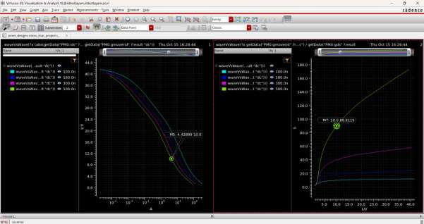
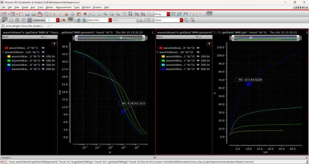
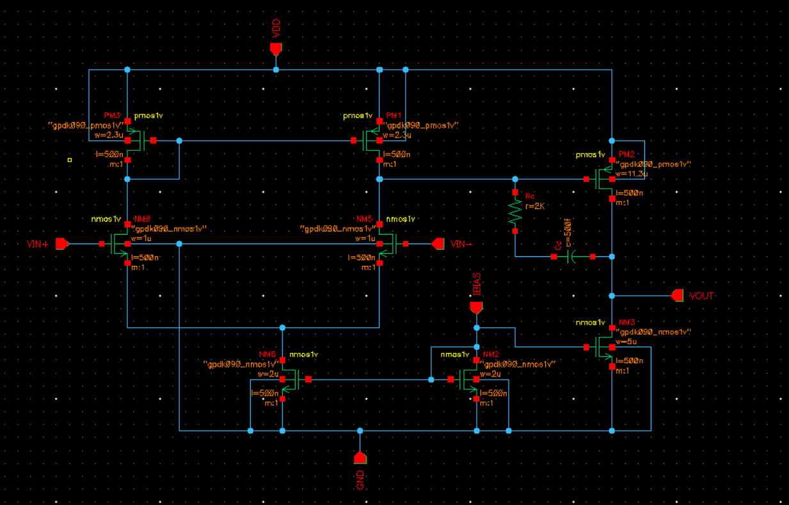
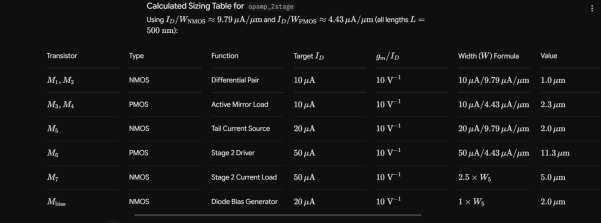
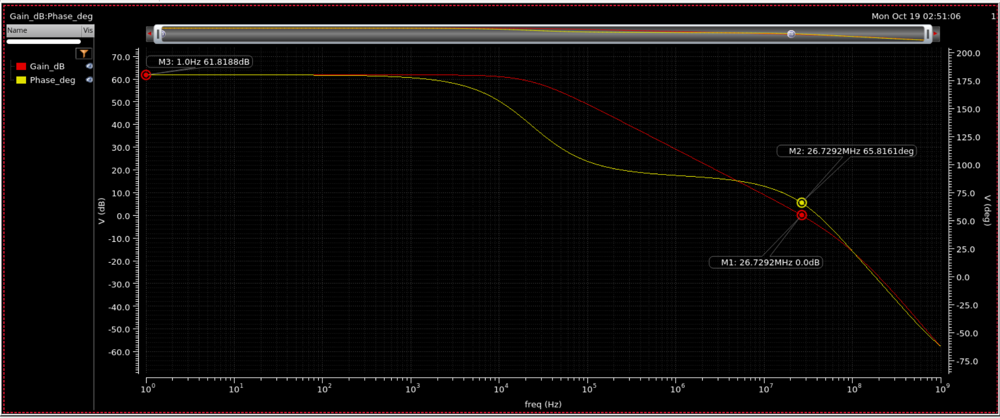
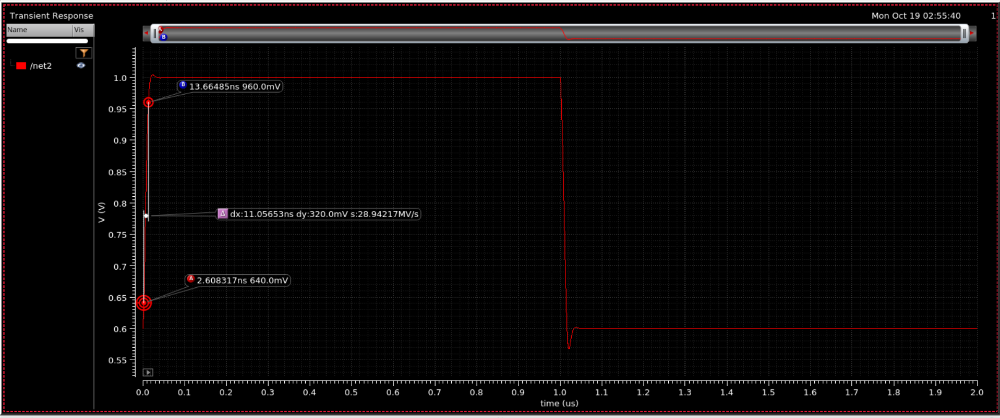
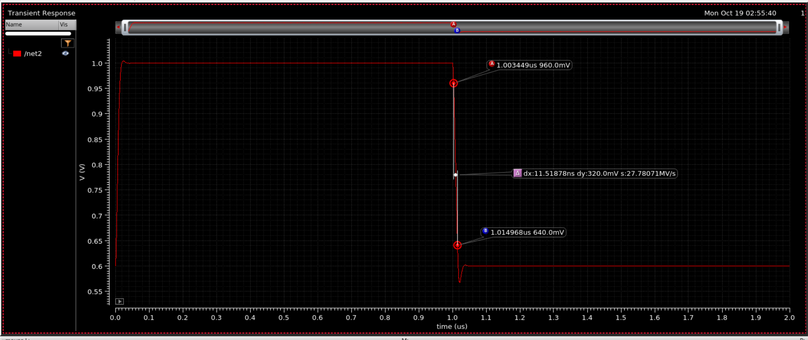

# 1.2 V Two-Stage Miller-Compensated CMOS Op-Amp in 90 nm (gm/ID Design)

Transistor-level design of a two-stage Miller-compensated operational amplifier on Cadence **GPDK090** (90 nm CMOS) with a 1.2 V supply. Because square-law equations are unreliable at this node (short-channel effects), every device is sized from **gm/ID charts** extracted from single NMOS and PMOS simulations. Designed and simulated in **Cadence Virtuoso (ADE, Spectre)**.

**Course:** Analog Electronics, B.Tech ECE, Indian Institute of Information Technology Kottayam

**Team**

| Name | Roll number |
|---|---|
| Amal Krishnan | 2025BEC0006 |
| Ojas Sharma | 2025BEC0010 |
| Jones Roy Mathew | 2025BEC0013 |

The project abstract is in [`docs/project_abstract.pdf`](docs/project_abstract.pdf).

---

## Results Summary

Nominal simulation conditions, CL = 1 pF. Slew rate is measured in a unity-gain buffer.
<!-- TODO: confirm the AC testbench load capacitor is 1 pF before publishing -->

| Specification | Target | Achieved | Status |
|---|---|---|---|
| Technology | GPDK090 | GPDK090 | Met |
| Supply voltage | 1.2 V | 1.2 V | Met |
| Open-loop DC gain | ≥ 50 dB | **61.82 dB** | Met |
| Unity-gain bandwidth | ≥ 20 MHz | **26.73 MHz** | Met |
| Phase margin | ≥ 60° | **65.8°** | Met |
| Slew rate | ≥ 10 V/µs | **28.9 V/µs** rising, **27.8 V/µs** falling | Met |
| Power dissipation | ≤ 1 mW | **106.4 µW** | Met |
| Load capacitance | 1 pF | 1 pF | Met |

All specifications in the project abstract are met at nominal conditions.

---

## Design Flow

1. **Characterize** single NMOS and PMOS devices (DC sweep of VGS at several channel lengths) and extract gm/ID vs ID/W and gm/ID vs gm·ro.
2. **Choose the operating point.** All devices use gm/ID = 10 V⁻¹ (moderate inversion) and L = 500 nm. The longer length gives much better intrinsic gain than minimum length, which is needed to reach the gain target with two stages.
3. **Size from the charts.** W = I<sub>D</sub> ÷ (I<sub>D</sub>/W at the chosen gm/ID and L). At gm/ID = 10 and L = 500 nm: I<sub>D</sub>/W ≈ 9.79 µA/µm (NMOS) and ≈ 4.43 µA/µm (PMOS).
4. **Set currents** with a 20 µA bias reference and mirror ratios.
5. **Compensate** with a Miller capacitor and nulling resistor, then tune for UGB and phase margin.
6. **Verify** with DC operating point, AC, transient and power measurements.

---

## 1. Device Characterization

gm/ID versus ID/W and gm·ro curves for L = 100 nm, 180 nm, 300 nm and 500 nm.

**PMOS**



**NMOS**



---

## 2. Circuit and Sizing

### Schematic



| Block | Devices | Function |
|---|---|---|
| Stage 1 | NM0, NM5 (NMOS diff pair), PM3, PM1 (PMOS mirror load), NM8 (NMOS tail) | Differential to single-ended gain |
| Stage 2 | PM2 (PMOS common source), NM3 (NMOS current-source load) | Extra gain and output swing |
| Bias | NM2 (diode-connected NMOS), 20 µA reference | Sets tail and second-stage currents |
| Compensation | C<sub>c</sub> in series with R<sub>z</sub>, from stage-1 output to V<sub>OUT</sub> | Pole splitting; R<sub>z</sub> moves the right-half-plane zero |

### Sizing table

All devices use **L = 500 nm** and **gm/ID = 10 V⁻¹**.

| Transistor | Type | Function | Target I<sub>D</sub> | W |
|---|---|---|---|---|
| Diff pair | NMOS | Differential pair | 10 µA each | 1.0 µm |
| Mirror load | PMOS | Active mirror load | 10 µA each | 2.3 µm |
| Tail | NMOS | Tail current source | 20 µA | 2.0 µm |
| PM2 | PMOS | Stage 2 driver | 50 µA | 11.3 µm |
| NM3 | NMOS | Stage 2 current load | 50 µA | 5.0 µm (2.5 × tail) |
| NM2 | NMOS | Diode bias generator | 20 µA | 2.0 µm |



**Compensation and bias:** C<sub>c</sub> = **500 fF**, R<sub>z</sub> = **2 kΩ**, I<sub>BIAS</sub> = 20 µA, input common mode = 0.6 V, V<sub>DD</sub> = 1.2 V.

---

## 3. Simulation Setup

**AC and DC testbench.** The op-amp is wrapped in a symbol. Both inputs sit at 0.6 V DC with ±0.5 V AC (1 V differential), a 20 µA bias current source feeds IBIAS, and the output drives the load capacitor.


**Transient testbench.** The op-amp is connected as a unity-gain buffer with C<sub>L</sub> = 1 pF and a pulse input stepping from 0.6 V to 1.0 V.


---

## 4. Results

### AC response

DC gain **61.82 dB**, unity-gain bandwidth **26.73 MHz**, phase margin **65.8°** at the unity-gain frequency.



### Transient slew rate

Unity-gain buffer, output stepping between 0.6 V and 1.0 V. Slew rate is measured between the 640 mV and 960 mV points of each edge (a 320 mV swing). The small overshoot and undershoot settle back to the final values.

| Edge | Δt | Slew rate |
|---|---|---|
| Rising | 11.06 ns | 28.94 V/µs |
| Falling | 11.52 ns | 27.78 V/µs |

**Rising edge**



**Falling edge**



### Power dissipation

A DC operating-point analysis on the V<sub>DD</sub> source gives a supply current of 88.68 µA at 1.2 V, so the total power is **106.4 µW**, well below the 1 mW limit.


<!-- TODO: confirm each device's VDS is above Vdsat in the DC operating point before claiming saturation -->

---

## Design Iterations

| Step | Change | Outcome |
|---|---|---|
| 1 | Initial gm/ID sizing and compensation | Gain 61.81 dB, UGB 13.6 MHz, PM ≈ 63°. UGB below the 20 MHz target |
| 2 | C<sub>c</sub> reduced to 300 fF, NM3 widened to 8 µm | Gain fell to about 32 dB. NM3 sank about 80 µA while PM2 was sized for 50 µA, upsetting the second-stage bias |
| 3 | NM3 restored to 5 µm, C<sub>c</sub> = 500 fF | Gain 61.82 dB, UGB 26.74 MHz, PM ≈ 61.2° |
| 4 (final) | R<sub>z</sub> raised from 1 kΩ to 2 kΩ | PM 65.8°, UGB 26.73 MHz, all specifications met |

---

## Verification Status

| Item | Status |
|---|---|
| gm/ID characterization (NMOS, PMOS) | Done |
| DC operating point | Done |
| AC: gain, UGB, phase margin | Done |
| Transient slew rate | Done |
| Power dissipation | Done |
| PVT corners (SS / FF, temperature) | Not covered |
| CMRR, PSRR, noise | Not covered |
| Input common-mode range sweep | Not covered |
| Layout, DRC/LVS, post-layout extraction | Not covered |

---

## Repository Structure

```
two-stage-miller-opamp-90nm/
├── README.md
├── .gitignore
├── docs/
│   └── project_abstract.pdf
└── images/
    ├── characterization/
    │   ├── nmos_gmid_idw_gmro.jpg
    │   └── pmos_gmid_idw_gmro.jpg
    ├── schematic/
    │   ├── opamp_schematic.png
    │   ├── sizing_table.jpg
    │   ├── testbench_ac_dc.jpg
    │   └── testbench_transient.jpg
    └── results/
        ├── ac_response.png
        ├── slew_rising.png
        ├── slew_falling.png
        └── power_dc_op.jpg
```

---

## Reproducing the Results

1. In Virtuoso, create a library attached to the GPDK090 technology library.
2. Draw the schematic from section 2 using `nmos1v` and `pmos1v`, with the widths in the sizing table and L = 500n.
3. Add C<sub>c</sub> = 500f in series with R<sub>z</sub> = 2k between the stage-1 output and the op-amp output.
4. Make a symbol and build the testbenches from section 3 (VDD = 1.2 V, I<sub>BIAS</sub> = 20 µA).
5. Run the analyses:
   - **DC:** operating point (check device regions, read the supply current for power).
   - **AC:** 1 Hz to 1 GHz; read gain, unity-gain frequency and phase margin.
   - **Transient:** 0 to 2 µs unity-gain buffer step, 0.6 V to 1.0 V; measure the slew rate between 640 mV and 960 mV.

---

## Notes

- **PDK not included.** GPDK090 is Cadence's proprietary academic PDK. Only result images are in this repository; re-running the simulations needs a licensed GPDK090 install.
- Simulation screenshots are included as captured from Virtuoso.

---

## References

1. P. E. Allen and D. R. Holberg, *CMOS Analog Circuit Design*, Oxford University Press. Two-stage op-amp design procedure, Miller compensation and the nulling resistor.
2. P. G. A. Jespers and B. Murmann, *Systematic Design of Analog CMOS Circuits: Using Pre-Computed Lookup Tables*, Cambridge University Press, 2017. gm/ID methodology.
